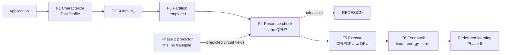

# hybrid-quantum-resource-mapper

[](https://github.com/abenehra21/hybrid-quantum-resource-mapper/actions/workflows/tests.yml)

**AI-driven task analysis and resource mapping for hybrid quantum–classical computing.**

Quantum processors are good at a narrow set of hard sub-problems, but they are small, noisy and slow to access.
Classical HPC handles everything else. Today, experts decide by hand which part of an application goes where.
This project automates that decision. It profiles an incoming task (qubits, gates, precision, hardware noise,
deadline) and routes it to **CLASSICAL** execution, a **HYBRID** quantum–classical workflow, or **REDESIGN** when
the task cannot work as posed. Every decision comes with a trace explaining why.

| Phase | Goal | Status |
|---|---|---|
| 1 · Rule-based prototype | Transparent decision rules, baseline runs, Phase 2 dataset | ✅ this repo |
| 2 · Resource prediction | ML models predict gate count, depth, shots, runtime, energy, error | ✅ this repo |
| 3 · AI task allocation | Learned classifier replaces or augments the rules | planned |
| 4 · Automatic partitioning | Split applications into classical/quantum subtasks (task DAG) | planned |
| 5 · QPU integration | Run selected workloads on real hardware, collect feedback | planned |
| 6 · Federated learning | Aggregate model updates across sites without sharing raw data | planned |



## Quickstart

```bash
python3.11 -m venv .venv && .venv/bin/pip install -e ".[test]"
.venv/bin/pytest

# Phase 1
.venv/bin/python -m hybrid_mapper decide --preset fes_sqd              # rule trace for a named profile
.venv/bin/python -m hybrid_mapper profile --workload maxcut --size 16  # build + transpile + profile
.venv/bin/python -m hybrid_mapper baselines --quick                    # ~1.5 min (full run ~25 min), appends to logs/decisions.csv

# Phase 2
.venv/bin/python -m hybrid_mapper predict --workload maxcut --size 80 --reps 2 --backend nighthawk_r2 --compare
.venv/bin/python -m hybrid_mapper dataset                              # regenerate data/resources.csv (~15 min)
.venv/bin/python -m hybrid_mapper report                               # write results/*.md
```

Common workload flags: `--workload {maxcut,vqe,random}`, `--size`, `--backend {heron_r3,nighthawk_r2}`,
`--reps` (QAOA p / ansatz layers / random-circuit depth), `--entanglement` (VQE ansatz), `--seed`.

---

## Phase 1: the rule-based decision engine

### The TaskProfile

| Tier | Fields | Cost to obtain |
|------|--------|---|
| Problem | `task_id`, `problem_class` {classical, chem, opt, dyn, samp}, `algorithm` {none, vqe, dyn, qaoa, sqd, samp}, `precision_target`, `deadline_min`, `classical_meets_target`, `low_entanglement` | free |
| Circuit | `n_qubits`, `depth`, `two_qubit_gates`, `sum_abs_coeffs`, `measurement_groups`, `samples_needed` | build + transpile (Phase 2 predicts these) |
| Hardware | `target_qpu`, `eplg`, `throughput_per_s`, `queue_wait_min`, `shot_budget` | backend calibration |

### Derived quantities (`rules.py`)

- Estimated fidelity: `F = exp(two_qubit_gates · ln(1 − eplg))`
- Algorithm kind: vqe, dyn → `expect`; qaoa, samp → `sample`; sqd → `recover`
- Shots: `expect` → `(sum_abs_coeffs / precision)² / F²`; `sample`/`recover` → `samples_needed`
- QPU seconds: `shots / throughput`. Statevector bytes: `16 · 2^n_qubits`

### The rules

The rules are checked in order and the first one that fires decides, so cheap checks come first. Every threshold
is in [`config/rules.yaml`](config/rules.yaml) and the QPU specs are in
[`config/backends.yaml`](config/backends.yaml). A test proves that editing the YAML changes decisions without
any code change.

| Rule | Condition | Decision | Reasoning |
|------|-----------|----------|-----------|
| R1 | `problem_class == classical` or `algorithm == none` | CLASSICAL | No quantum algorithm applies, so there is nothing to map. |
| R2 | statevector fits in `statevector_memory_gib` (16 GiB ⇔ n ≤ 30) | CLASSICAL | Exact simulation on a workstation beats any noisy QPU run. |
| R3 | `low_entanglement` | CLASSICAL | Tensor-network or MPS methods handle weakly entangled states efficiently. |
| R4 | `classical_meets_target` | CLASSICAL | If a classical method already reaches the target, the QPU adds cost but no value. |
| R5 | `n_qubits` > backend qubits | REDESIGN | The circuit does not fit: it needs cutting, a smaller active space, or fragmentation. |
| R6 | `F < fidelity_min[kind]` (expect 0.05, sample 0.01, recover 1e-4) | REDESIGN | The output would be mostly noise. The tolerance depends on how much signal the algorithm can recover. |
| R7 | `shots > shot_budget` | REDESIGN | The measurement cost is unaffordable: group terms, lower precision, or switch algorithm. |
| R8 | `queue_wait_min + qpu_seconds/60 > deadline_min` | CLASSICAL | The QPU cannot answer in time, so fall back to classical. |
| R9 | otherwise | HYBRID | The task is feasible. The quantum/classical split comes from `templates.py`. |

### Same circuit, opposite decision: `fes_sqd` vs `fes_vqe`

Both are spec-only profiles based on the published IBM–RIKEN SQD experiment ([4Fe-4S], 77 qubits,
3,500 two-qubit gates on heron_r3, so F ≈ 5.35e-4). No circuit is built for them.

```
$ python -m hybrid_mapper decide --preset fes_sqd
DECISION: HYBRID  (fired R9)
  algorithm kind recover | F 0.0005351 | shots 3e+06 | QPU seconds 750
  R1  pass  task has a quantum algorithm candidate
  R2  pass  77 qubits: statevector 2.25e+15 GiB exceeds 16 GiB
  R3  pass  entanglement not flagged as low
  R4  pass  no classical method known to meet the target
  R5  pass  77 qubits fit on heron_r3 (156)
  R6  pass  F=0.000535 >= F_min[recover]=0.0001
  R7  pass  shots 3e+06 <= budget 1e+07
  R8  pass  queue+QPU 72.5 min <= deadline 480 min
  R9  FIRE  all checks passed: run sqd as hybrid workflow on heron_r3

$ python -m hybrid_mapper decide --preset fes_vqe
DECISION: REDESIGN  (fired R6)
  algorithm kind expect | F 0.0005351 | shots 8.732e+15 | QPU seconds 2.183e+12
  R1–R5 pass
  R6  FIRE  F=0.000535 < F_min[expect]=0.05
```

SQD only needs noisy samples and recovers the signal classically, so a fidelity of about 5e-4 is usable. VQE needs
accurate expectation values, and at the same fidelity the 1/F² mitigation overhead pushes the shot count to about 10¹⁶.

All presets are pytest cases: `h2_vqe` and `maxcut20` → R2, `maxcut120` → R4, `maxcut120_open` → R9,
`fes_sqd` → R9, `fes_vqe` → R6, `lin_solve` → R1, `deep_random` → R6.

### Baselines and the proposal's metric table

`baselines` runs small instances (≤ 8-qubit VQE, ≤ 12-node Max-Cut) under each strategy:

- **classical**: exact diagonalisation (VQE Hamiltonians) or brute-force Max-Cut.
- **hybrid**: VQE/QAOA optimised with calibrated SPSA on qiskit-aer, using the FakeFez noise model.
  The *projected* runtime replaces simulation time with estimated QPU time (shots ÷ throughput).

Each run appends one row per (workload, strategy) to `logs/decisions.csv`: every profile field, the decision,
and the measured runtime, estimated energy, QPU time, QPU round trips, shots, error and success. `report` turns
this into the proposal's comparison table. It adds an **oracle** label (the cheapest strategy that meets the
accuracy target) and reports the rule engine's decision accuracy and regret.

**Results** (full run, 7 workloads; details in [`results/phase1_baselines.md`](results/phase1_baselines.md)):

| Metric (mean per workload) | Classical-only | Hybrid (always) | Rule-based mapper | Oracle |
|---|---|---|---|---|
| Runtime, projected (s) | 0.005 | 54.7 | 0.005 | 0.005 |
| Energy, estimated (J) | 1.46 | 1.37e6 | 1.46 | 1.46 |
| Accuracy (mean relative error) | 0 | 0.106 | 0 | 0 |
| QPU time, estimated (s) | 0 | 54.6 | 0 | 0 |
| Number of shots | 0 | 2.18e5 | 0 | 0 |
| Success rate (rel. error ≤ 5%) | 100% | 57% | 100% | 100% |
| Communication overhead (QPU round trips) | 0 | 106 | 0 | 0 |

The rule engine sends all seven small workloads to classical execution via R2 and matches the oracle every time
(100% decision accuracy, zero regret). At this size that is the expected result, not a trivial one: exact
simulation takes milliseconds, while noisy hybrid runs take about a minute of QPU time. Hybrid QAOA found the
optimal cut on every graph, but hybrid VQE missed the target by 8–37% under the capped SPSA budget and the device
noise. Workloads large enough for the decision to become contested cannot be simulated to get an oracle label.
That gap is what Phase 5 (real QPU feedback) closes.

---

## Phase 2: resource prediction

**Why predict when you can transpile?** Circuit-level fields cost a build plus a transpile, which takes about 1–2 s
per task and can reach ~30 s when a layout has no clean embedding. Phase 4 will need to score many candidate
partitions quickly. Predicting from problem-level fields lets the framework reject hopeless options before
building anything.

**Data.** `dataset` sweeps Max-Cut/QAOA (p = 1–3), EfficientSU2 VQE (linear, circular and full entanglement,
1–4 layers) and random circuits from 6 to 120 qubits on both backends. Each row is labelled with the exact
transpiled two-qubit gate count, depth and measurement groups (`data/resources.csv`, 608 rows). The labels
cost no QPU time.

**Models** (`predict.py`), one per target:

| Model | What it is | Expected behaviour |
|---|---|---|
| `analytic` | closed-form count before routing: 2·p·\|E\| (QAOA), reps·pairs (EfficientSU2) | the baseline to beat; no SWAP overhead |
| `power-law` | log-linear ridge per (family, backend, entanglement): log y ~ log n + log reps + log analytic | learns the routing overhead, and extrapolates |
| `gbt` | gradient-boosted trees on all features | strong inside the training range, but cannot extrapolate |

**Results** (details in [`results/phase2_prediction.md`](results/phase2_prediction.md)). The headline test is
*extrapolation*: train on ≤ 40 qubits and predict 50–120 qubits.

| Target (extrapolation, MAPE) | analytic | power-law | gbt |
|---|---|---|---|
| two-qubit gates | 51% | **14.5%** | 41% |
| depth | — | **19%** | 37% |
| measurement groups | (no grouping) | **1.5%** | 3.7% |

| Predicted fields → Phase 1 rules (extrapolation) | analytic | power-law | gbt |
|---|---|---|---|
| decision agrees with exact-transpile decision | 69% | **95.8%** | 90% |
| median error in log₁₀ F | 0.79 | **0.14** | 0.27 |

- **The power-law model beats the analytic baseline** on every target. It learns the routing (SWAP) overhead
  that 2·p·|E| misses.
- **Trees are as good as the power-law inside the training range** (98.7% decision agreement in both on the
  random split), but they fall behind on larger sizes. This is the expected tree failure mode, and it is the
  reason to prefer a model family that extrapolates.
- **Speed:** predicting and deciding takes about 2 ms per task. Exact transpilation takes a median of 0.7 s,
  and 20 of 608 took over 10 s, up to 30 s.
- **Execution outcomes** (runtime, energy, error) are fitted with leave-one-out on the 7 hybrid runs. The
  power-law beats a mean predictor on all three (for example, runtime MAE is 11.7 s vs 36.8 s), but n = 7 means
  these numbers only show that the pipeline works. They grow with every `baselines` run.

**Deciding without transpiling:**

```
$ python -m hybrid_mapper predict --workload maxcut --size 80 --reps 2 --backend nighthawk_r2 --compare
PREDICTED with power-law model in 3.0 ms (no transpile)
DECISION: HYBRID  (fired R9)
  R6  pass  F=0.0123 >= F_min[sample]=0.01
COMPARE with exact transpile (518 ms):
  two_qubit_gates      predicted     1465   exact     1519
  depth                predicted      658   exact      708
  decision             predicted HYBRID (R9)   exact HYBRID (R9)

$ python -m hybrid_mapper predict --workload maxcut --size 80 --reps 2 --backend heron_r3 --compare
PREDICTED with power-law model in 2.3 ms (no transpile)
DECISION: REDESIGN  (fired R6)
  R6  FIRE  F=0.00678 < F_min[sample]=0.01
COMPARE with exact transpile (367 ms):
  two_qubit_gates      predicted     2320   exact     2448
  decision             predicted REDESIGN (R6)   exact REDESIGN (R6)
```

The same 80-node problem is feasible on Nighthawk's square lattice but not on Heron's heavy-hex. The difference
comes from routing overhead that the analytic formula (2·p·|E| = 480 gates on both) cannot see.

---

## Repository layout

```
hybrid_mapper/
  profile.py     TaskProfile dataclass + JSON
  backends.py    QPU specs from config/backends.yaml, transpile targets
  profiler.py    F1: build, transpile (optimization_level=3), fill circuit fields
  rules.py       F2+F4: derived quantities, ordered rules, decision trace
  templates.py   F3: fixed classical/quantum split per algorithm
  workloads.py   Max-Cut/QAOA, synthetic-Hamiltonian VQE, random circuits
  presets.py     named reference profiles (also test cases)
  baselines.py   classical vs hybrid runs -> logs/decisions.csv
  dataset.py     Phase 2 sweep -> data/resources.csv
  predict.py     Phase 2 models, evaluation, predicted profiles
  report.py      results/phase1_baselines.md, results/phase2_prediction.md
  cli.py         python -m hybrid_mapper {decide,profile,baselines,dataset,predict,report}
config/          backends.yaml, rules.yaml (every threshold, weight and assumption)
data/            resources.csv (Phase 2 training data)
results/         generated reports
tests/           pytest suite (presets, config-driven thresholds, formulas, models)
```

## Limitations

- **Fidelity model.** `F = (1 − eplg)^N₂q` ignores single-qubit, readout, crosstalk, idling and leakage errors,
  so it is optimistic. The residual against measured fidelity is a natural Phase 2/5 learning target.
- **Mitigation overhead.** 1/F² is a rough estimate. Real PEC/ZNE/PEA costs depend on the method and the noise.
- **Thresholds are hypotheses.** The 30-qubit line depends on the simulating machine, and F_min values are
  starting points. All of them live in `rules.yaml`, and learning them is the point of Phase 3.
- **Hand-supplied flags.** `classical_meets_target` and `low_entanglement` are not inferred; they default to False.
- **Topology proxy.** nighthawk_r2 is transpiled to a 10×12 square grid, not a calibrated device model.
- **Synthetic chemistry.** VQE Hamiltonians are seeded random bounded-weight Pauli sums (`synthetic_hamiltonian`),
  not molecular data.
- **Simulated hybrid runs.** Runtimes are projected (QPU time from throughput), and energy uses *assumed* power
  figures in `rules.yaml` (QPU power attributed by share of QPU time). Hybrid accuracy reflects a capped SPSA
  budget and the FakeFez noise model.
- **Small execution dataset.** Runtime, energy and error models train on a handful of simulated runs. The report
  prints n next to every number. Transpiler-labelled resources (608 rows) are the solid part of Phase 2.
- **Prediction scope.** Predictors cover the three workload families in the sweep. A new family needs new
  training rows.
